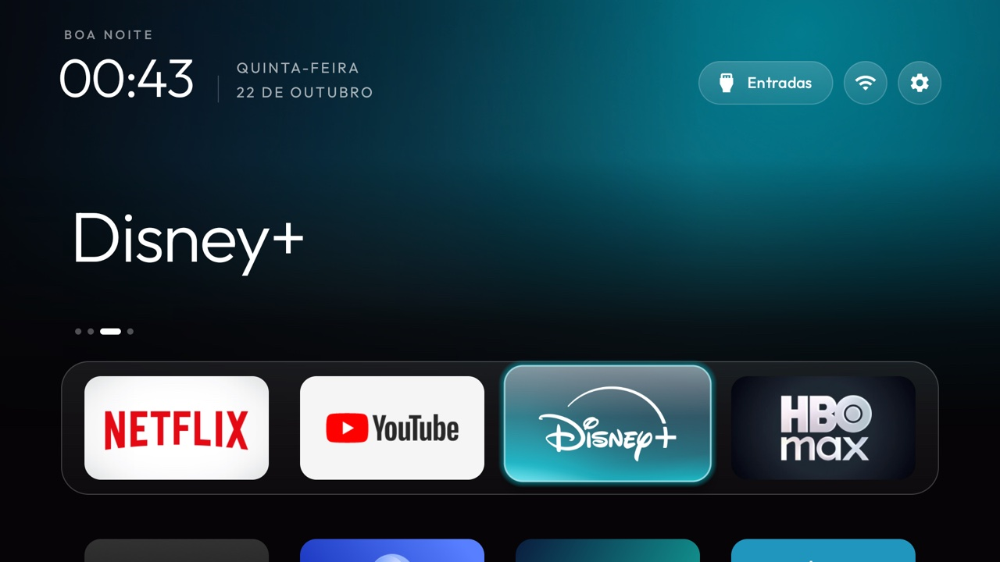

# CleanYourTV 玻璃主题定制版（自动天气）

> 基于 [CleanYourTV](https://cleanyour.tv)（MIT，作者 Gathin）的定制构建。在原版简洁桌面的基础上，预置**玻璃主题**并内置**主界面自动天气**。



## 功能特性

- **玻璃质感主题**：底部快捷栏玻璃拟态、环境光晕、电影感首页；应用库胶囊已隐藏（仅保留右上角入口），桌面更干净。
- **主界面自动天气**：根据电视出口 IP 自动定位城市，顶部显示 `温度° 天气 · PM2.5 数值`（例如 `17° 晴间多云 · PM2.5 103`）。数据来自 Open-Meteo（免 API Key、纯 HTTPS），每 30 分钟刷新；断网时屏上提示错误而不崩溃。
- **无需 root / 刷机**：通过 ADB 安装并设置默认桌面即可。
- **主题可换**：玻璃主题通过 `config.json` 叠加，无需重新编译；想换回内置默认，删除电视上的配置文件即可。

## 仓库结构

```
clean-your-tv-glass/
├── README.md                 # 本说明
├── LICENSE                  # MIT（原作者 Gathin，含本定制说明）
├── app-release.apk          # 已编译好的定制版桌面（约 483KB）
├── themes/
│   └── glass/               # 玻璃主题：config.json + 壁纸 + 截图
├── tools/
│   ├── install.sh           # macOS / Linux / Git Bash 一键安装
│   └── install.bat          # Windows 一键安装
└── src/
    └── WeatherFetcher.java  # 自动天气源码片段（透明参考）
```

## 适用设备

- Android TV / Google TV（Android 8 及以上），已开启**开发者选项 → USB 调试**（同时开启网络调试更佳）。
- 一台与电视同一局域网的电脑，已安装 [Android 平台工具](https://developer.android.com/tools/releases/platform-tools)（`adb` 在 PATH 中）。

## 安装

### 方式 A：一键脚本（推荐）

1. 电视开启 USB 调试，记下电视局域网 IP（例如 `192.168.1.50`）。
2. 电脑连同一 Wi-Fi / 局域网，运行脚本（把 IP 换成你的）：

   **Windows（cmd）：**
   ```bat
   set TV_HOST=192.168.1.50
   tools\install.bat
   ```
   **macOS / Linux / Git Bash：**
   ```bash
   TV_HOST=192.168.1.50 bash tools/install.sh
   ```

3. 电视上**首次会弹窗授权 USB 调试**，勾选"一律允许"后确认；脚本会安装 APK、推送玻璃主题并**自动重启电视**。
4. 电视重启后，再次在电视上授权 USB 调试（如需），并把 **CleanYourTV 设为默认桌面**（弹窗选"总是"）。
5. 进入桌面，顶部即可看到自动天气。

### 方式 B：手动

```bash
adb connect 192.168.1.50:5555
adb install -r app-release.apk
adb push themes/glass/config.json /data/local/tmp/cyt-config.json
adb shell "cat /data/local/tmp/cyt-config.json | content write --uri content://com.gathin.tvhome.theme/config.json"
adb push themes/glass/wallpaper.jpg /data/local/tmp/cyt-wp.jpg
adb shell "cat /data/local/tmp/cyt-wp.jpg | content write --uri content://com.gathin.tvhome.theme/wallpaper.jpg"
adb reboot
```

重启后在电视上把 CleanYourTV 设为默认桌面即可。

## 常见问题

- **装完天气不显示 / 显示错误？** 安装或更新 launcher 后，Android 的网络权限映射可能未及时刷新，导致天气请求被拦截（表现为 `EPERM`）。本脚本已在最后执行 `adb reboot` 解决；若手动安装后天气异常，**重启一次电视**即可。
- **怎么换回内置默认主题？** 删除电视上的 `/sdcard/Android/data/com.gathin.tvhome/files/config.json`（或用原版 `tools/theme.sh --reset`），重启桌面生效。
- **天气定位不准？** 默认按出口 IP 做城市级定位。如需固定城市，在 `themes/glass/config.json` 增加 `"weather_location": "31.23,121.47"`（纬度,经度）后重新推送并重启。
- **底部应用怎么改？** 编辑 `themes/glass/config.json` 的 `dock_apps` 列表与 `app_labels`，重新推送主题即可，无需重编。

## 许可证

基于 [CleanYourTV](https://cleanyour.tv) 修改分发，遵循原 **MIT 许可证**（见 `LICENSE`）。本定制版改动：玻璃主题配置、主界面自动天气（`src/WeatherFetcher.java`）。
